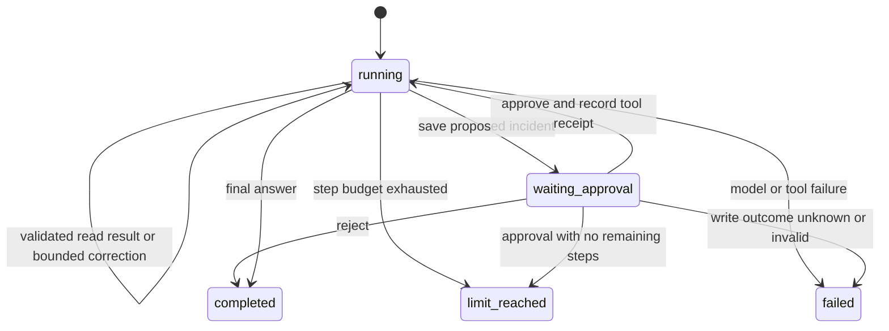

# Operations Agent Harness design

A local FastAPI service exposes a browser chat and an HTTP API. Each user message starts a bounded run in a persistent conversation. DeepSeek selects tools and interprets their results. The offline model provides repeatable acceptance scenarios. Creating an incident requires a separate approval request.

## Execution and trust boundaries

Python 3.11+, Pydantic and a fixed registry validate both directions of each tool call. FastAPI runs synchronous routes in worker threads. Each execution drives async model and tool calls with per-call deadlines. SQLite transactions persist the run state across requests. The demo model follows the supplied service snapshots and the OPS-17 rule. The live adapter uses httpx and DeepSeek Chat Completions in non-thinking mode. It validates every call in a batch before dispatch, executes read calls sequentially within the run budget and returns one tool result per original call ID. A write must arrive as a separate proposal. Invalid batches consume the normal correction budget. [DeepSeek tool calling](https://api-docs.deepseek.com/guides/tool_calls/)

## Source comparisons and design decisions

| Source | Behavior in the reference implementation | Decision for this harness |
| --- | --- | --- |
| OpenAI Agents SDK | The runner stores a turn limit with run state and uses that limit on resume. [Runner source](https://github.com/openai/openai-agents-python/blob/4e162c79a4a951c6fc8b698d5c8279c1963c099b/src/agents/run.py) | Each run stores its own step ceiling. A database update checks the run is active and has budget before charging a model or tool attempt. Changing the server default only affects new runs. |
| LangGraph | An interrupt exposes a pending value. A resume command supplies input to that interrupt, and the interrupted node can execute again. [Interrupt and Command source](https://github.com/langchain-ai/langgraph/blob/b4fe40f8108cea6a8314aaaafc7680395a257e3f/libs/langgraph/langgraph/types.py) | Persist an explicit action ID and argument snapshot. Resume at the approved write boundary. A repeated decision encounters the existing receipt before any side effect can run again. |
| Pydantic AI | Toolsets expose tool discovery and invocation. The approval wrapper checks the call context before delegating execution. [Toolset source](https://github.com/pydantic/pydantic-ai/blob/6e0c53611a06d2c7f47ad3f02f974ba158756f97/pydantic_ai_slim/pydantic_ai/toolsets/abstract.py) · [Approval wrapper source](https://github.com/pydantic/pydantic-ai/blob/6e0c53611a06d2c7f47ad3f02f974ba158756f97/pydantic_ai_slim/pydantic_ai/toolsets/approval_required.py) | Each tool declares named input and output schemas and an explicit access policy. The model adapter uses those definitions to advertise tools, and the runner uses them to validate and route calls. |

The runner depends on a small model protocol. Each adapter receives the objective, up to 12 prior turns with answers and verified outcomes, the current tool exchanges and correction feedback. SQLite rows, budgets and approval decisions stay in the execution layer. A schema rejection for a recognized call is sent back with the original call ID and a structured tool error. A response that cannot be parsed receives a plain correction. Both paths share the same correction budget.

## Database schema

| Table | Purpose and constraints |
| --- | --- |
| runs | Run ID, indexed conversation ID, objective, status, original step ceiling, steps consumed, final text and stop reason. Older runs become single-turn conversations identified by their run ID. Earlier databases receive the original default of 12 steps on upgrade. |
| run_events | Ordered timestamped events indexed by run and sequence. Payloads include call IDs, validated results, latency, attempt number and failure codes where applicable. |
| approvals | Action ID, run and model call IDs, frozen arguments, decision and response. A unique partial index allows one pending action per run. |
| incidents | Mock external system with one unique action ID per incident and the approved title, description and severity. |

Each user message creates a run. Adding a turn takes a SQLite write lock and checks that the preceding turn has finished. A competing follow-up while the conversation is busy receives HTTP 409. The browser stores recent conversation IDs and titles locally and reloads the full history from SQLite.

An approval transaction acquires a write lock, checks the previous decision and budget, and loads the stored parameters. A SQLite savepoint covers the mock write and receipt validation. The receipt must match the incident row for the approved action. A failure rolls back the local write while preserving the approval decision, budget charge and failure trace. The lock is released before contacting the model. A repeated decision returns the saved response, or a current snapshot if the original request is finishing. Conflicting decisions return HTTP 409. An interrupted process can resume pending approvals. On startup, orphaned running investigations are marked failed with their history and committed receipts preserved.

## Failures and observability

Every model attempt and tool attempt consumes one of 12 steps. Human wait time consumes none. Each model call has a 20-second deadline and each tool call has a 3-second deadline. A transient read failure gets one retry. A malformed model request gets one correction per run. Invalid tool output fails the run. An ambiguous incident timeout records an unknown outcome and ends execution. Log events contain the run ID, event type and operational labels. The persistent trace contains the objective, tool arguments and results for local inspection.

The pytest suite exercises HTTP, concurrent duplicate approval, restart, malformed model and tool data, real coroutine timeouts, bounded retries, budget exhaustion and simulated DeepSeek HTTP exchanges through approval and resume. The Postman collection exercises the service at its public HTTP entry points.

## Design principles and limits

| Principle | Implementation and scope |
| --- | --- |
| Inspectable execution | Each model and tool attempt consumes a step and produces a trace entry or termination reason. A reviewer can follow the run from the original question to the tool observations and final result. [Building effective agents](https://www.anthropic.com/engineering/building-effective-agents) |
| Relevant context | The live model receives up to 12 prior user turns with replies and verified outcomes. Current tool results include complete matching runbooks from a two-document corpus. A larger corpus would need ranked excerpts and a token budget. [Tool design](https://www.anthropic.com/engineering/writing-tools-for-agents) · [Context engineering](https://www.anthropic.com/engineering/effective-context-engineering-for-ai-agents) |
| Recoverable approval | An approval binds the action ID to exact arguments. SQLite preserves the decision and receipt across restarts. A run interrupted while active ends with an explicit failure reason. [Long-running harnesses](https://www.anthropic.com/engineering/effective-harnesses-for-long-running-agents) |
| Outcome-based evaluation | Tests inspect the incident ledger, frozen arguments and trace. Simulated DeepSeek responses exercise the tool protocol. The offline model encodes the sample runbook threshold in Python. Its test results measure execution behavior, not live model accuracy. [Agent evaluations](https://www.anthropic.com/engineering/demystifying-evals-for-ai-agents) |

## Deployment limits and future work

- **Model quality.** Evaluate live responses against paired cases around the 10-minute threshold, a changed runbook, a read-only request and an unknown service. Score the final observations, proposed incident and committed receipt. Record the model ID, latency and usage.
- **Access control.** The loopback service assumes one trusted operator. A shared deployment requires authenticated users, conversation-level authorization and approver identity in the audit log.
- **External systems.** Service snapshots and incidents are local fixtures. A real telemetry adapter would need source timestamps. A remote incident writer would need an idempotency key and reconciliation after an uncertain response.
- **Execution.** The service runs in a single process. Multiple workers would require ownership leases and recovery for interrupted work. The browser renders live text from DeepSeek as it arrives. Streaming tool arguments are assembled by call index, then validated before dispatch. Closing the page leaves the bounded run active. On refresh the browser reads its saved status and final answer. Partial text is transient.
